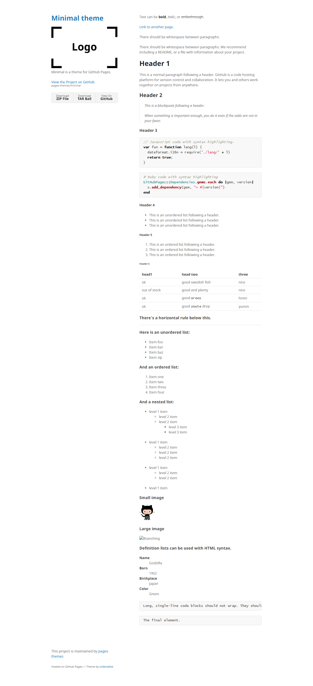
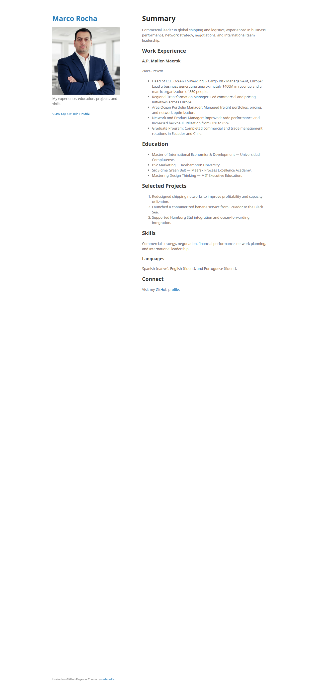

# How I Built My GitHub Pages E-Portfolio

## Introduction

This guide explains how I created my personal e-portfolio with GitHub Pages and the Minimal Jekyll theme. It covers the initial repository setup, adding the theme, personalizing the portfolio, and publishing the site. I used the standard Minimal theme process; I did not attempt the optional side quest or use a different theme.

## Milestone I: Creating the Portfolio

### 1. Create a GitHub Pages repository

I created a repository on GitHub named `marcorocha-nam.github.io`. A personal Pages repository follows the naming pattern `<github-username>.github.io`, which gives the published website its address: [marcorocha-nam.github.io](https://marcorocha-nam.github.io/).

### 2. Clone the repository to my computer

I cloned the new repository to my computer so I could edit its files locally. In GitHub, I opened the repository, selected **Code**, copied the repository URL, and used Git or Visual Studio Code to clone it.

### 3. Download the Minimal theme

Because my personal Pages repository already had its required name, I did not fork the theme. I opened the [Minimal theme repository](https://github.com/pages-themes/minimal), selected **Code**, and downloaded the project as a ZIP file.

### 4. Add the theme files to my repository

I unzipped the downloaded project and copied its contents into the local folder for `marcorocha-nam.github.io`. I kept the theme's supporting folders and files, including its assets, layouts, and configuration files.

### 5. Configure the theme and portfolio details

I configured `_config.yml` to use `jekyll-theme-minimal` and set the site's title, description, headshot image, and download-button preference. The theme reads these settings when GitHub Pages builds the site.

### 6. Write my portfolio homepage

I replaced the sample homepage content in the root `index.md` with my professional information. I organized it into a summary, work experience, education, selected projects, skills, languages, and contact link. Markdown headings, lists, italics, and hyperlinks help structure the page.

### 7. Commit, publish, and check the site

After making the changes, I committed and pushed them to GitHub. I checked the repository's **Actions** tab for the Pages build and deployment, then visited [my published portfolio](https://marcorocha-nam.github.io/) to confirm the site was live.

## Milestone II: Creating This Subpage

To make a nested page, I created a folder named `how-i-built-my-e-portfolio` and placed this `index.md` file inside it. Jekyll uses the folder structure to organize pages, so this guide is available at [marcorocha-nam.github.io/how-i-built-my-e-portfolio](https://marcorocha-nam.github.io/how-i-built-my-e-portfolio/).

I also added a **Projects** section to the homepage with a link to this guide, then committed and pushed both changes. After GitHub Pages deployed them, the homepage link led to this subpage.

## Screenshots and Resources

The first screenshot shows the standard Minimal theme demo before personalization.

This final screenshot of my Milestone I portfolio shows my name and headshot, portfolio description, and professional sections. It was captured before adding the Milestone II guide link.

### Resources

- [Minimal theme source repository](https://github.com/pages-themes/minimal)
- [Minimal theme demo](https://pages-themes.github.io/minimal/)
- [GitHub Pages documentation](https://docs.github.com/en/pages)
- [Visual Studio Code Markdown preview](https://code.visualstudio.com/docs/languages/markdown#_markdown-preview)

[Back to my portfolio homepage](../)
